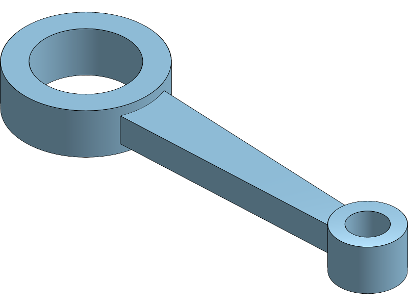
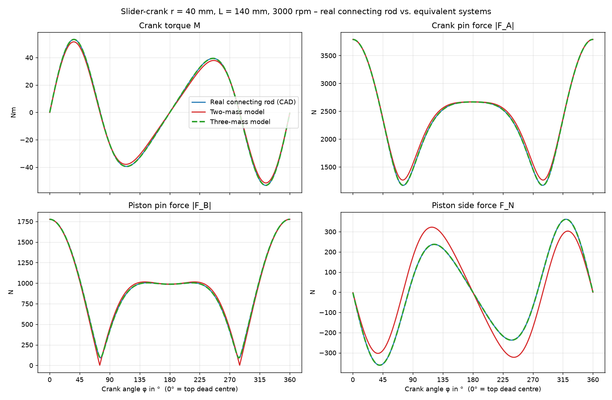

# Connecting Rod vs. Equivalent System in a Slider-Crank (Onshape + MuJoCo)

**Task:** Model an arbitrarily shaped connecting rod in CAD, compute an equivalent mass system,
and compare the real rod with its simplification in a multibody simulation.
Instead of MATLAB/Simscape Multibody, **MuJoCo** is used (approved by the lecturer).



## Workflow

1. **CAD (Onshape):** steel connecting rod, eye distance 140 mm, big end Ø60/Ø40,
   small end Ø28/Ø16, tapered shank.
   [Onshape document](https://cad.onshape.com/documents/58673a9c2392640e143eef2a/w/d2ad0901c46b3c07f468e29f/e/295d2ed6f445d3b626ea09f8)
   – mass, centre of mass and inertia tensor are stored in `conrod_data.json`, the mesh in `assets/conrod.stl`.
2. **Equivalent systems** (`equivalent_system.py`):
   - Two-mass model (statically equivalent): point masses at the big and small end
   - Three-mass model (dynamically equivalent): an additional mass at the centre of mass so that
     the moment of inertia matches as well
3. **Multibody simulation** (`slider_crank.py`): three identical slider-crank mechanisms
   (r = 40 mm, piston 350 g, constant 3000 rpm); only the connecting rod differs. The closed loop
   is closed by a joint constraint at the piston pin. Evaluated over one revolution: crank torque,
   crank pin force, piston pin force and piston side force.

## Results (summary)

| Model | m_A | m_S | m_B | J about S |
|---|---|---|---|---|
| Two-mass | 320.64 g | – | 147.15 g | +31.2 % too large |
| Three-mass | 244.41 g | 111.21 g | 112.17 g | exact |

| Quantity | Peak (real) | Deviation two-mass | Deviation three-mass |
|---|---|---|---|
| Crank torque | 53.3 Nm | 3.6 % | 0.00 % |
| Crank pin force | 3789 N | 2.7 % | 0.00 % |
| Piston pin force | 1776 N | 5.5 % | 0.00 % |
| Piston side force | 361 N | **28.5 %** | 0.00 % |

The two-mass model preserves mass and centre of mass but not the moment of inertia; the error
shows up mainly in the piston side force. The three-mass model is dynamically equivalent and
gives the same results as the real rod for planar motion.



**Validation:** piston acceleration vs. the analytic solution (0.005 % deviation),
piston pin force at TDC vs. m·r·ω²·(1+λ) (1776.5 N vs. 1776.6 N), torque error of the
two-mass model vs. ½·ΔJ·λ²·ω² (1.897 Nm vs. 1.893 Nm).

All numbers and figures: `results/SUMMARY.md`, `results/comparison_forces_torques.png`,
`results/deviations.png`, CSV time histories `results/history_{real,two,three}.csv`.

## Installation

Requires Python ≥ 3.12. Dependencies: `mujoco`, `numpy`, `matplotlib`
(exact tested versions in `requirements.txt`).

**With pip:**

```bash
python -m venv .venv
source .venv/bin/activate          # Windows: .venv\Scripts\activate
pip install -r requirements.txt
```

**With [uv](https://docs.astral.sh/uv/):** `uv sync` creates `.venv` and installs the same
versions from `uv.lock`. Then prefix the commands below with `uv run`.

If ROS is installed, run `unset PYTHONPATH` first (or prefix commands with `env -u PYTHONPATH`);
ROS's PYTHONPATH interferes with the virtual environment.

## Running

```bash
python equivalent_system.py          # compute the equivalent systems
python slider_crank.py               # simulation + plots (about 2 s)
python slider_crank.py --rpm 6000    # different speed
python slider_crank.py --gravity     # with gravity
python view.py                       # watch it in the MuJoCo viewer (60 rpm)
```

## Files

| File | Content |
|---|---|
| `requirements.txt` | Python dependencies with tested versions (pip) |
| `pyproject.toml`, `uv.lock` | the same for uv |
| `conrod_data.json` | mass properties exported from Onshape (SI units) |
| `assets/conrod.stl` | rod geometry (mm) |
| `equivalent_system.py` | two- and three-mass models, derivation in the docstring |
| `slider_crank.py` | MuJoCo model, simulation, evaluation, plots |
| `view.py` | interactive viewer |
| `slider_crank.xml` | generated MJCF model (blue = real rod, red spheres = point masses) |
| `results/` | plots, CSV data, `SUMMARY.md` |

## Assumptions

Planar motion, rigid bodies, frictionless, no gas force, constant crank speed,
gravity neglected by default (inertia forces at 3000 rpm ≈ 400 g).
